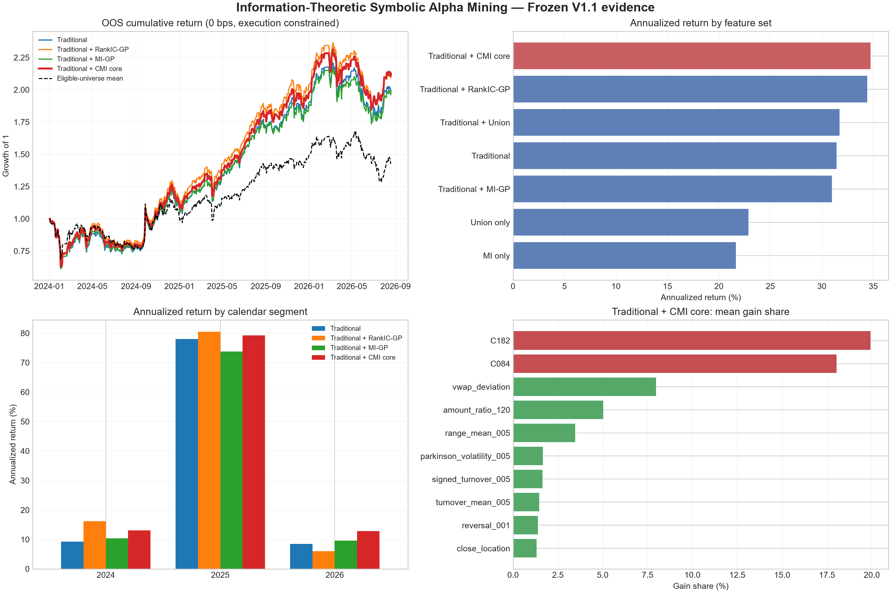
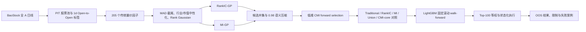

# Information-Theoretic Symbolic Alpha Mining

## 基于增量预测信息的 A 股非线性因子挖掘与组合研究

本项目研究两个问题：Mutual Information（MI）能否扩展 RankIC 的因子发现空间；Conditional Mutual Information（CMI）能否从高冗余候选中识别真正具有增量信息的因子。研究对象为全 A 股日频横截面，主标签是可执行的下一交易日开盘到再下一交易日开盘收益。

实验结果显示，RankIC-GP 与 MI-GP 产生了不同的候选主题。两路候选合并并经过低维 CMI 后置压缩后，两个核心因子在 LightGBM 对照实验中取得最高的样本外点估计；纯 MI 因子库未超过传统因子基线，CMI-core 相对基线的增量未达到统计显著。

## 核心结果

使用 Point-in-Time 数据口径、32 个固定滚动 walk-forward folds、Top-100 等权和状态化执行约束。OOS 为 2024-01-02 至 2026-08-19，共 637 个交易日。下表是 **0 bps** 结果，只用于比较信息与模型，不代表成本后的实盘净收益。

| 特征集合 | 因子数 | 年化收益 | Sharpe | 最大回撤 | 年化超额 | Mean RankIC |
|---|---:|---:|---:|---:|---:|---:|
| Traditional + CMI core | 207 | **34.75%** | **1.096** | -37.32% | **16.16%** | 0.0642 |
| Traditional + RankIC-GP | 238 | 34.43% | 1.088 | -38.07% | 15.95% | **0.0651** |
| Traditional + Union | 262 | 31.72% | 1.035 | -37.36% | 13.75% | 0.0649 |
| Traditional | 205 | 31.42% | 1.010 | -38.81% | 13.79% | 0.0637 |
| Traditional + MI-GP | 229 | 30.99% | 1.003 | -39.01% | 13.42% | 0.0634 |
| Union only | 57 | 22.89% | 0.896 | -27.29% | 5.45% | 0.0596 |
| MI only | 24 | 21.65% | 0.852 | -23.81% | 4.57% | 0.0577 |

`Traditional + CMI core` 相对传统基线的配对日收益增量为 0.94 bps/日，算术年化 2.37%。



## 研究设计



时间语义固定为：

$$
y^{1d}_{i,t}=\frac{Open_{i,t+2}}{Open_{i,t+1}}-1.
$$

因子 $f_{i,t}$ 只能使用交易日 $t$ 收盘时可得的信息；$t+1$ 开盘买入，$t+2$ 开盘卖出或调仓。

## 代码分块

| 模块 | 主要职责 | 核心入口 |
|---|---|---|
| 数据与标签 | 下载日线、PIT 股票池、标签与未来执行状态 | `src/data/`、`scripts/build_lightgbm_final_v11_data.py` |
| 因子与预处理 | 205 个传统因子、MAD、中性化、Rank Gaussian | `src/factors/`、`src/preprocessing/` |
| 信息论估计 | Histogram MI、KL entropy、KSG MI、Frenzel–Pompe CMI、置换检验 | `src/information/` |
| 符号因子挖掘 | 表达式树、受保护算子、岛屿 GP、RankIC/MI 双通道 | `src/symbolic/`、`scripts/run_large_gp_cluster.py` |
| 候选压缩 | 语义近重复压缩与低维 CMI forward selection | `scripts/run_v2_lowdim_cmi_selection.py` |
| 模型与验证 | 因子组装、Rank-Gaussian 目标、日期等权、滚动 walk-forward、LightGBM | `src/models/`、`scripts/run_lightgbm_final_v11.py` |
| 组合执行 | Top-100 等权、涨跌停/停牌、延迟卖出与现金席位 | `src/portfolio/execution_constraints.py` |
| 最终分析 | 冻结结果、配对不确定性和报告图 | `scripts/build_final_report_assets.py`、`results/final/` |

更具体的公式—函数对应关系见 [代码结构说明](docs/CODE_GUIDE.md)，估计器推导见 [方法与样本估计](docs/METHODOLOGY.md)。

## GitHub 目录

```text
information_alpha/
├── README.md
├── pyproject.toml
├── requirements.txt
├── configs/                    # 冻结的数据、GP 与模型配置
├── src/
│   ├── factors/                # 传统量价因子
│   ├── preprocessing/          # 截尾、中性化、标准化
│   ├── information/            # entropy / MI / CMI / significance
│   ├── symbolic/               # expression tree 与岛屿 GP
│   ├── models/                 # walk-forward 与 LightGBM
│   ├── portfolio/              # 组合与执行约束
│   └── validation/             # 因子评价指标
├── scripts/                    # 正式流水线入口
├── cluster/                    # 长任务的 Slurm 入口
├── tests/                      # 少量核心正确性测试
├── results/final/              # 冻结结果与图，不含原始大数据
└── docs/
    ├── CODE_GUIDE.md
    ├── METHODOLOGY.md
    ├── REPRODUCIBILITY.md
    ├── RESEARCH_REPORT.md
    └── STRATEGY_ITERATION.md
```


## 快速开始

### 1. 安装

```bash
python -m venv .venv
source .venv/bin/activate          # Windows: .venv\Scripts\activate
python -m pip install -r requirements.txt
```

### 2. 运行核心测试

```bash
python -m pytest -q tests/test_core_*.py
```

这些测试只覆盖会改变研究结论的错误：标签时间对齐、截面中性化、KSG/CMI 合成校准、表达式无未来函数和 walk-forward 隔离。

### 3. 重建报告图

```bash
python scripts/build_final_report_assets.py
```

此命令只读取冻结结果，不训练模型、不重新选择因子。

### 4. 完整复现

原始行情和中间 Parquet 因体积与数据许可不进入 Git。完整数据准备、集群 GP、CMI 筛选和 LightGBM 命令见 [复现说明](docs/REPRODUCIBILITY.md)。

## 结果应如何解读

- MI 是无方向的依赖度量。高 MI 不等于正向收益，也不保证条件均值可交易。
- RankIC 与 Q10-Q1 天然偏好单调关系，不能单独裁决 MI 因子的价值。
- `C084` 呈中间区间占优、极端值受罚的非单调形状；`C182` 主要是负向单调因子。
- 两个 CMI-core 因子在 32 个 folds 中都获得正 gain，合计平均 gain share 为 37.96%，但 gain 是模型内条件重要性，不是因果贡献。
- 2026 年两个核心因子均出现衰减，说明需要状态监控和再训练规则。

## 文档

- [完整研究报告](docs/RESEARCH_REPORT.md)
- [方法与有限样本估计](docs/METHODOLOGY.md)
- [代码结构与公式映射](docs/CODE_GUIDE.md)
- [一键复现与集群说明](docs/REPRODUCIBILITY.md)
- [后续策略迭代方向](docs/STRATEGY_ITERATION.md)
- [最终结果证据包](results/final/README.md)
