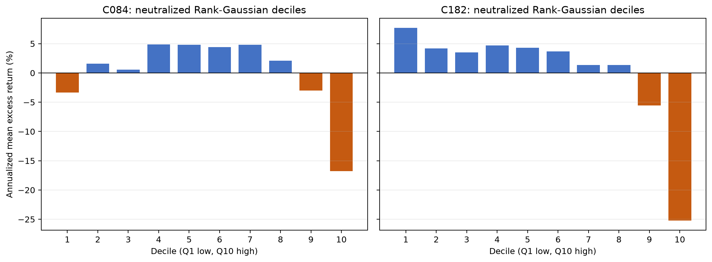

# 基于增量预测信息的 A 股非线性因子挖掘与组合研究

## 摘要

传统量化因子通常用 Pearson IC 或 Spearman RankIC 衡量。它们分别擅长线性和单调关系，却可能遗漏 U-shape、threshold、saturation、非对称和条件交互等非线性结构。本研究建立了一条完整的全 A 股日频研究链：Point-in-Time 股票池与可执行 Open-to-Open 标签、205 个传统量价因子、从零实现的 Histogram MI、Kozachenko–Leonenko entropy、KSG MI 与 Frenzel–Pompe CMI、RankIC/MI 双通道岛屿 Genetic Programming、语义近重复压缩、低维 CMI forward selection、LightGBM walk-forward 和状态化交易执行。

合成实验首先证明，在 quadratic 与 inverse-U 关系中 Pearson 与 Spearman 近零，而 KSG MI 明显为正。金融 panel 的置换校准进一步显示：在存在强时间依赖的 null 下，IID permutation 的假阳性率达到 62.5%，20 日 block permutation 将其恢复到 5%。这说明金融 MI 不能只计算一个正数，而必须配套与依赖结构相容的 null distribution。

大规模 V2 搜索在 2022 selection 上分别运行 RankIC-GP 与 MI-GP。两路各 24,576 个 population slots，得到 15,403 与 14,910 个唯一结构。2023 development validation 表明 MI-GP 的 pooled KSG MI 中位数高于 RankIC-GP，但方向性 RankIC 与 Q10-Q1 较弱。两路候选代表不同主题，却在各通道内部高度冗余：139 个 $|\rho|<0.99$ 代表的 participation-ratio effective rank 仅约 1.43。把阈值收紧到 $0.98$ 后得到 57 个代表，再用低维 CMI forward selection 选出 `C084`（MI 来源）与 `C182`（RankIC 来源），第三步未超过共享 block max-null，因而停止。

最终 V1.1 采用修复后的数据契约和状态化执行，对七组特征进行 32-fold 固定滚动 LightGBM OOS 检验。区间为 2024-01-02 至 2026-08-19，共 637 个交易日。0 bps 下，Traditional + CMI core 的年化收益为 34.75%、Sharpe 1.096、最大回撤 -37.32%，是七组最高点估计；Traditional + RankIC-GP 为 34.43%、1.088；Traditional 基线为 31.42%、1.010；Traditional + MI-GP 为 30.99%、1.003。CMI core 相对传统基线的配对增量为 0.94 bps/日，Newey–West $t=1.31$，20 日 moving-block bootstrap 算术年化 95% 区间为 $[-1.01\%,5.99\%]$，尚不能拒绝零增量。

结果显示，MI 扩展了候选空间，CMI 可用于后置低维去冗余；MI fitness 未全面替代 RankIC，两个核心因子的收益增量未达到统计显著。

## 1. 研究问题

本项目回答七个问题：

1. MI 能否发现 RankIC 难以刻画的非线性预测关系？
2. 这些关系在严格时间外推中是否保留？
3. CMI 能否识别已有因子之外的增量信息？
4. 信息型去冗余是否优于只看相关系数？
5. CMI 后置筛选是否优于直接把全部 GP 候选交给模型？
6. MI 候选是否能被 LightGBM 转化为增量 OOS 表现？
7. 在执行约束、选择偏差和多重检验之后，结论是否仍成立？

## 2. 证据层级

项目把证据分为四层：

1. **Estimator evidence**：合成分布中是否恢复已知真值；
2. **Development evidence**：2022 选择、2023 验证与置换筛选；
3. **Model evidence**：冻结候选进入相同 LightGBM 后是否提高 OOS；
4. **Trading evidence**：执行约束、成本、容量与新未见样本后是否仍成立。

高 MI 只属于依赖证据；通过 permutation 只说明偏离特定 null；高 gain 只说明模型使用了特征；高回测收益才接近经济证据，但仍需成本、容量和独立 holdout。把这些层级混在一起，是因子挖掘中最常见的过度结论来源。

## 3. 数据与时间定义

### 3.1 数据范围

- 数据源：BaoStock 全 A 股日线；
- 下载区间：2015-01-01 至 2026-08-21；
- 股票数：5,466；
- V1.1 clean panel：10,361,322 行；
- LightGBM 准备后：8,627,702 行，其中 8,627,620 行有有效监督目标；
- OOS 完整预测截面：3,053,310 行；
- OOS：2024-01-02 至 2026-08-19，共 637 个交易日。

### 3.2 股票池

信号日 $t$ 的合格股票满足：

- 当日正常交易；
- 当日非 ST；
- 上市至少 60 个交易日；
- OHLCV、成交额与换手字段有效；
- OHLC 关系合法；
- 信号日本身未触及项目约定的涨跌停过滤条件。

上市年龄按交易日历计算，不按自然日。停牌日不会被 forward-fill 后当成零收益、零波动或零成交量。

### 3.3 标签

$$
y_{i,t}^{1d}=\frac{Open_{i,t+2}}{Open_{i,t+1}}-1.
$$

因子在 $t$ 收盘后计算，$t+1$ 开盘买入，$t+2$ 开盘卖出。标签满足 T+1，并避免以已经看完 $t$ 日 Close/Volume 的信号假设在 $Close_t$ 成交。

## 4. 传统因子库

第一阶段生成 205 个传统 OHLCV 因子：

| 类别 | 数量 |
|---|---:|
| Distribution statistics | 32 |
| Volatility | 30 |
| Volume | 24 |
| Liquidity | 24 |
| Turnover | 23 |
| Intraday structure | 20 |
| Price-volume interaction | 20 |
| Relative strength | 18 |
| Momentum | 9 |
| Reversal | 5 |

这些因子不是为了覆盖所有卖方公式，而是给后续信息论与 GP 一个正确、可解释的基线。窗口主要为 2、3、5、10、20、40、60、120 日。所有 rolling 操作按股票、按时间升序，并只使用当前和历史数据。

## 5. 预处理

正式顺序为：

$$
Raw\rightarrow MAD(5)\ Winsorize
\rightarrow Industry/\log(FloatMCap)\ Neutralize
\rightarrow RankGaussian.
$$

先截尾可以避免少量数值异常主导中性化回归；先中性化再标准化保证模型与 MI 读取的是剔除行业/市值后的经济信号。若先做非线性 Rank Gaussian 再中性化，回归处理的是秩映射后的对象，不再等价于原因子的行业/市值残差。

Rank Gaussian 的公式为：

$$
u_{i,t}=\frac{Rank(f_{i,t}^{neutral})-0.5}{N_t},
\qquad
z_{i,t}=\Phi^{-1}(u_{i,t}).
$$

它对重尾因子和距离型 KSG 更稳定。理论 MI 对可逆变换不变，但有限样本 kNN 几何并不完全尺度不变，因此这个步骤仍然重要。

## 6. 为什么使用 MI

Mutual Information 为：

$$
I(X;Y)=H(X)+H(Y)-H(X,Y)
=D_{KL}\bigl(p(x,y)\Vert p(x)p(y)\bigr).
$$

它衡量所有形式的统计依赖，不限于线性或单调关系。金融解释是：观察因子后，未来收益分布的不确定性减少多少。

但 MI 有三个边界：

1. 它对称，不能给出交易方向；
2. 它可以来自条件方差或尾部，而不一定来自条件均值；
3. $\widehat I>0$ 可能只是有限样本偏差。

因此本项目从 Histogram MI 开始，逐步实现 KL entropy、KSG MI、permutation test，再进入真实金融 panel。

## 7. 合成 MI benchmark

下表取 $N=1{,}000$、噪声 0.25、30 个随机种子的均值：

| 关系 | Pearson | Spearman | Histogram $\widehat I$ | KSG $\widehat I$ |
|---|---:|---:|---:|---:|
| Independent | -0.0015 | 0.0006 | 0.0251 | -0.0022 |
| Linear | 0.9698 | 0.9718 | 1.1466 | 1.3645 |
| Quadratic | -0.0006 | -0.0022 | 0.8800 | 1.2728 |
| Sinusoidal | 0.2595 | 0.2542 | 0.4253 | 1.1679 |
| Threshold | 0.8154 | 0.7101 | 0.6108 | 0.6509 |
| Inverse-U | -0.0036 | -0.0033 | 0.8891 | 1.2841 |

Quadratic 与 inverse-U 直接展示了 $RankIC\approx0$、$MI>0$。Independent 的 Histogram MI 仍约 0.025，说明稀疏 bin 会产生正偏；KSG 平均接近零且允许轻微负值。这个实验不是为了证明 KSG 在所有情况下最优，而是确认实现可以区分独立、单调和非单调依赖。

## 8. 金融 panel 中的 MI

项目比较两种口径：

### 8.1 每日横截面

$$
\widehat I_t=\widehat I(f_{\cdot,t};y_{\cdot,t}).
$$

它给出时间稳定性，但单日 KSG 方差较大，股票之间也受共同冲击。

### 8.2 Rolling pooled

先逐日 Rank Gaussian，再把最近 $L$ 日样本联合估计。以 20 日窗口为例，momentum、volatility、Amihud 的 pooled MI 均比单日序列平滑，但不同窗口和不同标准化方式会改变结果。它不能被解释为 IID 样本中的固定参数，而是窗口混合分布下的依赖估计。

## 9. Null distribution 与 block permutation

观察到正 MI 不能直接判断有效。项目构造 null distribution：保持因子与 panel 结构，破坏因子与正确未来标签日期的对应。

Monte Carlo p-value：

$$
p=\frac{1+\sum_{b=1}^{B}\mathbb 1(T_b^{null}\ge T^{obs})}{B+1}.
$$

合成 calibration 在强序列依赖的独立 null 下得到：

| Null 方法 | 假阳性率 | Alternative power |
|---|---:|---:|
| IID permutation | 62.5% | 100% |
| 5 日 block | 20.0% | 100% |
| 20 日 block | **5.0%** | 100% |

IID permutation 破坏了波动聚集与自相关，使 null 过窄。20 日 block 在该合成设定中恢复了名义 5% 水平，因此成为后续 development screen 的默认块长。它不是证明真实市场恰好有 20 日依赖长度，而是比行级随机打乱更可信的近似。

## 10. Conditional Mutual Information

$$
I(X;Y\mid Z)=H(Y\mid Z)-H(Y\mid X,Z).
$$

若 $Z$ 表示已有因子，CMI 衡量新因子 $X$ 的 Incremental Predictive Information。Frenzel–Pompe estimator 在联合 $(X,Y,Z)$ 空间找第 $k$ 邻居半径，并在 $(X,Z)$、$(Y,Z)$ 与 $Z$ 投影空间共享半径计数，从而减少直接 entropy 相减的偏差。

合成 Gaussian 与非线性条件独立实验验证：共同原因可产生高边际 MI，但条件化后 $\widehat I(X;Y\mid Z)$ 接近零；真正的残差增量则保留正 CMI。实验也显示维数增加时邻域半径膨胀、信号保留下降，因此不能把数百个已有因子一次性塞入条件集。

## 11. Symbolic Alpha Mining

### 11.1 表达式空间

V2 使用 12 个无量纲 terminal：

```text
return_1d, gap_open, high_low_ratio, close_position,
body_to_range, volume_rel5, volume_rel20, amount_rel5,
amount_rel20, turnover_pct, turnover_rel20, volatility20
```

算子包括受保护四则运算、delay、delta、滚动均值/标准差/极值/秩/相关/协方差和横截面 rank。表达式最多 39 nodes、深度 9、历史 60 日、加权复杂度 32。

### 11.2 为什么用两个独立通道

RankIC fitness 与 MI fitness 优化不同对象。若把它们提前线性合成，需要人为决定量纲和权重，也会掩盖“MI 是否真的带来不同候选”这个研究问题。因此正式方案是：

$$
\mathcal C=mathcal C_{RankIC}\cup\mathcal C_{MI}.
$$

CMI 不进入 GP fitness。对每个个体、每代重复 CMI 会产生不可接受的计算成本，而且 fitness 依赖当前条件集 $S$；一个在错误 $S$ 下低 CMI 的候选仍可能有高边际信息或与另一个集合互补。

### 11.3 岛屿模型

每个通道配置：8 islands × 128 individuals × 24 generations，共 24,576 population slots。每 4 代做 ring migration，迁移 1 个 elite 与 2 个 novelty individuals。结构 hash、128-bit sign-invariant SimHash 和语义 Hamming 距离用于控制重复。

搜索期没有 stability/turnover soft penalty。稳定性和换手在候选产生后报告，避免事先把可能有信息但高换手的候选从研究空间删除。硬数值与复杂度约束仍保留。

## 12. V2 搜索结果

| 指标 | RankIC-GP | MI-GP |
|---|---:|---:|
| Population slots | 24,576 | 24,576 |
| 唯一结构 | 15,403 | 14,910 |
| Shortlist | 100 | 100 |
| 2023 directional RankIC 中位数 | 0.0717 | 0.0666 |
| 2023 pooled KSG MI 中位数 | 0.0444 | **0.0622** |
| 2023 毛 Q10-Q1 | 20.61 bps | 10.07 bps |
| Top-decile 单边换手 | 93.71% | 93.22% |

MI-GP 的验证 MI 比 RankIC-GP 高约 40%，说明 fitness 优化了它声称优化的对象。RankIC-GP 的方向性 RankIC 与 Q10-Q1 更高，这是单调目标的预期结果，不足以单独宣布 MI-GP 经济价值更弱。

两路的经济主题不同：RankIC 通道集中在“收盘位置 × 换手 × 波动/振幅”的方向性反转；MI 通道集中在“振幅及其滚动平滑 × 相对量价”的分布依赖。

但多样性仍不足：200 个候选在 $|\rho|\ge0.99$ 规则下保留 139 个代表，代表间绝对相关中位数 0.878，第一主成分解释 82.8%，effective rank 约 1.43。139 个候选在 999 次共享 20 日 block maxT 下全部显著，只能说明一个强共同主题显著，不能解释成 139 个独立 Alpha。

## 13. 从 139 到 57，再到 2

使用 2022 selection 的绝对相关图：

| 阈值 | 语义簇数 |
|---:|---:|
| 0.990 | 139 |
| 0.980 | 57 |
| 0.975 | 36 |
| 0.970 | 22 |
| 0.950 | 5 |

$0.98$ 被选为近重复计算压缩阈值，不被解释为理论独立性边界。57 个代表中，RankIC 来源 33 个、MI 来源 24 个。

低维 CMI forward selection：

| Step | 已有集合 | Winner | 分数 | Null 95% | 决策 |
|---:|---|---|---:|---:|---|
| 1 | $\varnothing$ | C084 | MI 0.06537 | 0.00896 | 选入 |
| 2 | C084 | C182 | CMI 0.00830 | 0.00552 | 选入 |
| 3 | C084, C182 | C102 | CMI 0.00364 | 0.00464 | 停止 |

CMI null 使用 99 次共享 20 日 label-block max screen。它是 selection-only multiplicity screen，不是精确 conditional randomization test，也不是最终 holdout 证明。

## 14. 两个核心因子

### 14.1 C084：MI 来源

原始表达式：

```text
add(
  add(
    rank(multiply(
      add(high_low_ratio, ts_mean(ts_mean(high_low_ratio,20),10)),
      ts_mean(ts_mean(high_low_ratio,3),5)
    )),
    rank(multiply(
      multiply(amount_rel20, ts_mean(high_low_ratio,20)),
      ts_mean(high_low_ratio,10)
    ))
  ),
  ts_mean(ts_mean(high_low_ratio,10),2)
)
```

它综合短中期振幅水平、振幅的平滑持续性和相对成交额。经济解释只能作为可检验假说：持续高振幅和放量可能表示注意力、风险承载或交易拥挤；极端状态可能进入价格冲击/反转区间，而中间状态保留较好的可预测收益。它不是简单“振幅越高越好”的单调公式。

### 14.2 C182：RankIC 来源

原始表达式：

```text
rank(multiply(
  multiply(
    amount_rel5,
    multiply(
      multiply(
        close_position,
        ts_mean(safe_div(add(high_low_ratio,return_1d),amount_rel5),60)
      ),
      turnover_pct
    )
  ),
  ts_max(multiply(
    delay(ts_min(volume_rel20,10),3),
    ts_min(multiply(volatility20,volume_rel20),2)
  ),20)
))
```

它将相对成交额、收盘位置、换手率、长期单位成交额价格运动、延迟相对成交量和近期波动—成交量极值组合。因子高值后的收益较差，可能反映高换手、高活跃和价格位置共同出现后的短期拥挤与反转。这个解释不是因果结论；它需要行业、事件和市场状态分解继续检验。

## 15. 单因子十分位结果

两个因子在 V1.1 OOS 中重新执行 MAD、中性化和 Rank Gaussian，再按 Q1--Q10 分组。下表是相对当日有效截面均值的算术年化超额：

| Decile | C084 | C182 |
|---:|---:|---:|
| Q1 | -3.35% | 7.69% |
| Q2 | 1.57% | 4.19% |
| Q3 | 0.54% | 3.48% |
| Q4 | 4.86% | 4.72% |
| Q5 | 4.82% | 4.32% |
| Q6 | 4.41% | 3.67% |
| Q7 | 4.82% | 1.38% |
| Q8 | 2.12% | 1.33% |
| Q9 | -3.02% | -5.57% |
| Q10 | -16.79% | -25.24% |



`C182` 基本是负单调信号。原始 Q10-Q1 为 -13.07 bps/日，Newey–West $t=-2.12$；若方向在 selection 阶段定义为负，Q1-Q10 的算术年化为 32.93%。

`C084` 更接近中间区间占优、极端值受罚。原始 Q10-Q1 只有 -5.33 bps/日且 $t=-0.71$，但事后描述性的 Q4--Q7 减去 Q1/Q9/Q10 为 4.94 bps/日、$t=1.91$。因为这个 contrast 是看到曲线后定义，不能作为预注册显著性结果；它只说明为什么单一 Q10-Q1 对 MI 因子不充分。

两个信号都在 2026 衰减。C182 的反向收益在 2024、2025 较强，2026 接近零；C084 的中间—极端形状在 2024、2025 为正，2026 基本消失。

## 16. LightGBM 设计

### 16.1 目标

每日把未来收益映射为 Rank Gaussian：

$$
\tilde y_{i,t}=\Phi^{-1}\left(\frac{Rank(y_{i,t})-0.5}{N_t}\right).
$$

优化日期等权 L2：

$$
\mathcal L=\sum_t\frac1{N_t}\sum_i(\tilde y_{i,t}-\hat y_{i,t})^2.
$$

没有使用 LambdaRank。Top-100 虽是头部排序任务，但直接使用 LambdaRank 会同时改变标签离散化、损失、group 和 early stopping，使“因子组差异”与“模型目标差异”混合。V2 LambdaRank 实验后来放弃，最终保持连续回归目标。

### 16.2 Early stopping

内部验证集使用与训练相同的日期等权 Rank-Gaussian L2。用验证 RankIC 会天然偏好单调信号，对 MI 因子不公平；每轮计算 KSG MI 则成本高、方差大且无方向。L2 是所有特征组共同、稳定和可复现的模型选择标准。

### 16.3 Walk-forward

- 720 个交易日固定滚动训练窗；
- 60 日 inner validation；
- inner gap 2 日；
- outer gap 2 日；
- 每个 OOS fold 20 日；
- step 20 日；
- 共 32 folds。

固定窗口让旧市场制度退出，比扩展窗口更适合非平稳市场。每个 fold 先在 inner train/validation 选择树数，再用测试日前最近 720 日重新训练，OOS 从不参与早停。

## 17. 组合与执行

每日按预测排序选 Top-100，等权 1%。状态化执行规则：

- $t+1$ 开盘涨停、停牌或变为不可买时，该席位留现金；
- $t+2$ 或后续开盘跌停/停牌时，旧持仓延续；
- 被困持仓占用资金；
- 停牌使用最近有效开盘估值，复牌跳空在复牌日确认；
- 不允许杠杆。

V1.1 中执行约束总体不频繁，但不是零。CMI-core 全区间有 49 个 blocked-buy slots、39 次 blocked-sell attempts，平均现金权重 0.063%，终点没有无法卖出的持仓。约束最集中在 2024-09-30 信号对应国庆后 2024-10-08 开盘等极端日期。

## 18. V1.1 最终结果

| 因子组 | 因子数 | 年化收益 | Sharpe | 最大回撤 | 年化超额 | Mean RankIC | 单边换手 |
|---|---:|---:|---:|---:|---:|---:|---:|
| Traditional + CMI core | 207 | **34.75%** | **1.096** | -37.32% | **16.16%** | 0.0642 | 61.63% |
| Traditional + RankIC | 238 | 34.43% | 1.088 | -38.07% | 15.95% | **0.0651** | 62.10% |
| Traditional + Union | 262 | 31.72% | 1.035 | -37.36% | 13.75% | 0.0649 | 61.47% |
| Traditional | 205 | 31.42% | 1.010 | -38.81% | 13.79% | 0.0637 | 60.43% |
| Traditional + MI | 229 | 30.99% | 1.003 | -39.01% | 13.42% | 0.0634 | 60.79% |
| Union only | 57 | 22.89% | 0.896 | -27.29% | 5.45% | 0.0596 | 62.53% |
| MI only | 24 | 21.65% | 0.852 | -23.81% | 4.57% | 0.0577 | 61.15% |

图见：


结果有四点：

1. CMI-core 与 RankIC 组非常接近，点估计差只有 0.086 bps/日；
2. Traditional + MI 没有超过传统基线；
3. Union 全量加入也没有超过 CMI-core，说明更多候选不等于更多增量信息；
4. MI-only 与 Union-only 有正毛收益，但显著弱于包含传统因子的模型。

## 19. 年度稳定性

| 因子组 | 2024 | 2025 | 2026 YTD |
|---|---:|---:|---:|
| Traditional | 9.31% | 77.99% | 8.50% |
| Traditional + RankIC | **16.14%** | **80.44%** | 5.97% |
| Traditional + MI | 10.38% | 73.70% | 9.57% |
| Traditional + Union | 12.48% | 75.34% | 7.21% |
| Traditional + CMI core | 13.09% | 79.27% | **12.83%** |
| Union only | 7.58% | 59.95% | -0.36% |
| MI only | 12.25% | 57.37% | -8.38% |

总体收益高度受 2025 市场环境影响。CMI-core 在 2026 YTD 的组合结果仍较好，但两个核心因子的单因子 decile 关系同时衰减，提示模型可能依赖与传统因子的条件交互或其他传统因子贡献，不能把整体表现简单归因于两个单因子。

2026 年 7 月七组收益均为正，未复现此前沪深 300 Top5 项目的当月回撤。这说明压力期结论高度依赖股票池、持仓集中度、标签和模型，不能从另一个项目直接迁移。

## 20. 配对不确定性

| 比较 | 日均差 | 算术年化差 | NW $t$ | 20 日 block 年化 95% CI |
|---|---:|---:|---:|---:|
| CMI core − Traditional | +0.940 bps | +2.37% | 1.31 | [-1.01%, 5.99%] |
| RankIC − Traditional | +0.854 bps | +2.15% | 0.97 | [-1.97%, 6.76%] |
| MI − Traditional | -0.149 bps | -0.38% | -0.23 | [-3.49%, 2.81%] |
| CMI core − RankIC | +0.086 bps | +0.22% | 0.13 | [-3.00%, 3.25%] |

CMI-core 是最好的点估计，但不能声称统计上战胜 RankIC 或传统基线。比较发生在已打开过的区间，而且研究过程经历多轮设计选择，所以表中的区间仍可能低估研究者适应性不确定性。

## 21. 为什么两个因子会优于 57 个因子

在 Traditional + CMI core 模型中：

- C182 平均 gain share 19.93%；
- C084 平均 gain share 18.03%；
- 两者合计 37.96%；
- 两者在全部 32 个 folds 中都有正 gain。

这并不意味着模型被人为偏向新因子。训练代码没有为 C084/C182 设置额外样本权重、feature weight 或特殊采样；七组使用相同超参数和目标。更合理的解释包括：

1. **条件增量**：两个因子在剔除同主题候选后，成为独特分裂变量；
2. **冗余分摊**：57 个高度相关因子同时存在时，gain 会在替代变量之间分散；
3. **有限容量**：固定深度和叶数下，大量冗余特征消耗分裂搜索与 bagging 机会；
4. **噪声竞争**：更多候选增加偶然局部分裂，未必提高 OOS；
5. **交互表达**：LightGBM 可以用 C084 的区间阈值与传统因子交互，而不是只按单调方向使用。

重要性是模型内条件量，不是 Shapley 因果归因。高 gain 不能替代 ablation；本项目真正的 ablation 是七组 OOS 对照，而该对照只给出点估计层面的积极结果。

## 22. 对核心问题的回答

### Q1：MI 能否发现 RankIC 遗漏的非线性关系？

**合成数据明确支持，真实数据部分支持。** C084 呈明显区间/阈值形状，MI 通道主题与 RankIC 通道不同。但真实 MI 候选通常仍有非零 RankIC，并非“纯 RankIC-blind”。

### Q2：这些关系是否严格 OOS 存在？

**存在点估计证据，但不够稳定。** CMI-core 总体最好，两个因子在 2026 的单因子关系衰减，增量置信区间跨零。

### Q3：CMI 能否识别增量 Alpha？

**有积极但未确认的证据。** 后置 CMI 从 57 个代表压缩到 2 个，点估计优于全量 Union；但不能排除幸运选择。

### Q4：信息型去冗余是否优于相关剪枝？

**方法上互补，经济上尚未单独隔离。** $0.98$ 相关阈值只负责近重复压缩，CMI 负责相对标签的增量。最终两阶段结果优于全量候选，但没有独立运行“仅相关剪枝 2 因子”作为同规模控制。

### Q5：CMI-based GP 是否优于 RankIC-GP？

**该原假设被研究设计修改。** CMI 不适合作为大规模 GP 内循环 fitness。正式方案是 RankIC-GP 与 MI-GP 并行，CMI 后置筛选。

### Q6：MI 新信息能否被 LightGBM 转化？

**部分能。** MI-only 和 Traditional + MI 没有胜出；但最佳 CMI-core 包含一个 MI 来源因子，且 LightGBM 稳定使用它。

### Q7：结果有直接交易价值吗？

**尚无。** 0 bps、约 37% 最大回撤、61% 日均单边换手、2026 衰减和非独立 holdout 都阻止直接部署。

## 23. 失败结果与研究修正

项目保留以下失败或被否定结果：

- 严格 RankIC-blind 搜索在早期真实因子库中没有产生可靠发现；
- CMI 作为 GP fitness 计算昂贵且依赖条件集，被放弃；
- stability/turnover penalty 版 MI-GP 不再作为主搜索；
- V1/V2 候选存在严重语义同质化；
- 139 个显著代表的有效维度很低；
- Traditional + MI 没有超过传统基线；
- LambdaRank V2 没有作为最终模型；
- 旧 clean panel 存在未来交易状态筛选，必须用 V1.1 修复；
- CMI-core 的增量未通过严格显著性门槛。

## 24. 实验口径与未覆盖项

1. **成本**：V1.1 为 0 bps；以 61% 日均单边换手计算，固定 10 bps 往返会显著侵蚀收益。
2. **基准**：内部基准是每日合格截面等权收益，不是中证全指可投资产品。
3. **风险**：没有行业权重、beta、Size、Liquidity、Volatility 或风格风险约束。
4. **容量**：没有订单金额/ADV 与冲击成本模型。
5. **数据**：仅使用日频 OHLCV 与月度 PIT 行业；没有基本面公告时点或复权事件的更完整供应商校验。
6. **涨跌停**：板块比例与分币价格规则已经进入执行，但历史特殊处理规则仍可能需要交易所级逐日表复核。
7. **选择适应性**：2023 被用于多轮开发，V1.1 又发生在原 holdout 打开之后。
8. **估计**：KSG/CMI 仍受维度、边界、ties、跨股票依赖和 regime mixing 影响。
9. **模型对照**：最终冻结结果没有补齐相同协议的 Ridge，无法完整量化“只有非线性模型能转化”的程度。
10. **状态衰减**：2026 的因子形状和部分模型早停树数显示信号弱化。

## 25. 结论

实验结果概括如下：

1. MI 在理论和合成数据上可以发现相关系数遗漏的非单调依赖；
2. 在真实 A 股因子搜索中，MI-GP 与 RankIC-GP 产生不同主题，因此候选并集有意义；
3. 大规模候选经后置增量筛选后，两个 CMI-core 因子的点估计高于 57 个高冗余候选组成的特征集。

研究流程如下：

$$
\text{双通道候选发现}
\rightarrow
\text{语义压缩}
\rightarrow
\text{低维增量信息筛选}
\rightarrow
\text{统一非线性模型检验}
\rightarrow
\text{执行与不确定性评价}.
$$

## 参考文献

1. Kozachenko, L. F. and Leonenko, N. N. (1987), [Sample Estimate of the Entropy of a Random Vector](https://www.mathnet.ru/eng/ppi797).
2. Kraskov, A., Stögbauer, H. and Grassberger, P. (2004), [Estimating Mutual Information](https://doi.org/10.1103/PhysRevE.69.066138).
3. Frenzel, S. and Pompe, B. (2007), [Partial Mutual Information for Coupling Analysis of Multivariate Time Series](https://doi.org/10.1103/PhysRevLett.99.204101).
4. Benjamini, Y. and Hochberg, Y. (1995), [Controlling the False Discovery Rate](https://doi.org/10.1111/j.2517-6161.1995.tb02031.x).
5. Ke, G. et al. (2017), [LightGBM: A Highly Efficient Gradient Boosting Decision Tree](https://proceedings.neurips.cc/paper_files/paper/2017/hash/6449f44a102fde848669bdd9eb6b76fa-Abstract.html).
